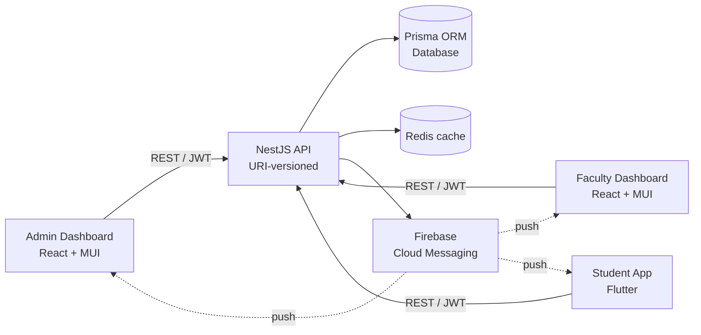
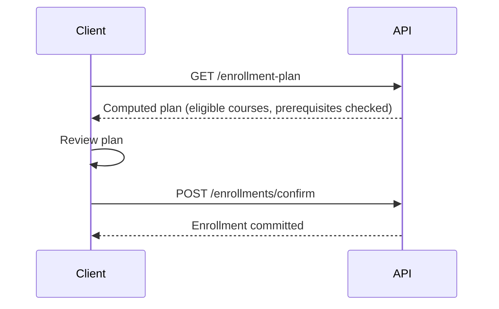
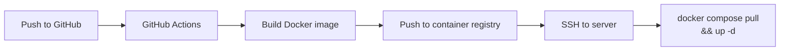

# University & Student Platform

A full-stack academic management platform built for a university client. It covers enrollment, scheduling, exams, student finances, reporting, and push notifications, with an **Arabic-first (RTL)** experience across every surface.

> 🔒 **Private client project.** Source code, data, and the client's name can't be shared. This repository is a public technical showcase of the architecture and engineering decisions. It contains no client data, credentials, or source code.

<!-- Add one line here on your role and the project's status, e.g. "Solo developer · in production since <month year>". -->

**The platform has four parts**

- **Backend API**: NestJS, Prisma, Redis caching
- **Admin Dashboard**: React, MUI, for university staff
- **Faculty Dashboard**: React, MUI, for faculty
- **Student App**: Flutter (Android, iOS, Web)

A custom **WordPress RTL theme** for the university's public website was built alongside the platform.

<!-- Add 2-3 redacted screenshots here (RTL dashboard, student app) -->

---

## Table of Contents

1. [System Overview](#system-overview)
2. [Backend](#backend)
3. [Domain Design](#domain-design)
4. [Frontend Applications](#frontend-applications)
5. [DevOps & Delivery](#devops--delivery)
6. [Engineering Highlights](#engineering-highlights)
7. [Tech Stack](#tech-stack)
8. [Author](#author)

---

## System Overview

| Component | Audience |
|-----------|----------|
| **Backend API** | All clients |
| **Admin Dashboard** | University staff |
| **Faculty Dashboard** | Faculty |
| **Student App** | Students |
| **University Website** | Public visitors |

---

## Backend

A **NestJS** modular monolith with **Prisma ORM**, **Redis** caching, and **Zod**-validated DTOs.

### Architecture

- **Modular structure**: one feature module per domain, with a global `PrismaModule` providing a single database client.
- **URI-based API versioning**, so clients can migrate between versions without breaking.
- **Dual, fully isolated authentication systems**:
  - Staff and students each have their own JWT strategy, signing secret, and user table.
  - A student token is rejected by every staff route, and vice versa.
  <!-- Confirm and state how faculty users authenticate (staff system or their own). -->
- **Validation at the edge**: request payloads are validated with Zod schemas turned into DTOs, so invalid input is rejected before it reaches business logic.
- **Soft deletes and voiding** preserve history instead of destroying records.
- **Prisma schema split into domain files** (academic structure, enrollment, finance, exams, notifications, and more) to keep a large schema maintainable.

### Caching

A **Redis** layer sits in front of read-heavy data, reducing database load for all three clients.

<!-- Add: what is cached (e.g. programs, semesters, schedules), the TTL strategy, and how entries are invalidated when an admin changes the data. -->

### Notification System

A single shared `NotificationModule` serves every user role through a **polymorphic recipient model**:

- A `RecipientType` enum lets one pipeline target staff and students without duplicating tables or services.
- Notifications carry **category, priority, status, actions, metadata, and expiry**.
- Per-user **notification settings** cover preferences and **quiet hours**.
- Delivery goes through a dedicated `PushChannelService` using **Firebase Cloud Messaging**, with device tokens stored per user.

### Reports

Report endpoints feed the dashboards' printable reports. Reports come from filterable queries and carry a **QR code** so a printed copy can be verified.

---

## Domain Design

### Academic Structure

Programs → curriculum → courses (with **prerequisites**) → semesters → **class sections** → **weekly schedule slots**. Schedule slots support per-day time ranges.

### Enrollment (two-phase)

Enrollment is split into **preview** and **commit**, so users see exactly what will happen before it does:

A **bulk initial enrollment** flow handles onboarding whole cohorts at once.

### Finance

| Concept | Design |
|---------|--------|
| **Fee structures** | Keyed by semester number, with **separate local and foreign student amounts** (a pricing tier, not a currency difference). |
| **Student fees** | Per-student charge rows: base amount, quantity, discount, title, description, due date, status, and **void tracking** (timestamp and reason). The final charge amount is resolved and stored on the row itself, not looked up later from the fee structure. |
| **Payments** | Payment date (separate from record creation), method, reference number, gateway response, status, processor, and receipt path. |
| **Reversals** | `Payments` has a **self-relation** for refunds and reversals, so the ledger is append-only and auditable. |
| **Re-exam fees** | A distinct fee type, separate from regular per-semester fees. |

The student app reads finances through **separate, focused endpoints** (transactions ledger, fee breakdown, payments) instead of one large summary call.

### Exams

Exam management with controlled **result publishing**, so results become visible only when published.

---

## Frontend Applications

### Admin Dashboard (React)

- **React + Vite + TypeScript + MUI**, built with pnpm.
- Programs and curriculum management, class sections, and a custom **weekly schedule field** with per-day time ranges.
- **Bulk enrollment dialogs**, plus fee and finance management.
- **Reports module**:
  - A report-type picker, then per-type report pages (student report first).
  - **Filters live in the URL query string**, so any report is a shareable, bookmarkable link.
  - Printed reports include a **verification QR code**.
- **Web push notifications** through Firebase (VAPID).
- **Multi-stage Docker build**: a Node build stage, then nginx serving the static `dist`.

### Faculty Dashboard (React)

- The faculty-facing client of the platform, built with the same stack and conventions as the Admin Dashboard: **React + Vite + TypeScript + MUI**, RTL-first.
- Shares the Admin Dashboard's Docker, nginx, and GitHub Actions delivery pipeline.

<!-- Add what faculty can actually do here (workflows, how permissions differ from admin). This section is the thinnest in the README. -->

### Student App (Flutter)

- **One codebase for Android, iOS, and Web.**
- **Networking**: Dio with interceptors for auth headers and token refresh. When a refresh fails, a session-expired handler routes the user to login.
- **Navigation**: GoRouter. **Dependency injection**: get_it.
- **Finance views**: a paginated transactions ledger (charges and payments merged), fee breakdown, and payments.
- **Notifications center** with typed items: info, warning, alert, and announcement.
- **Web build**: the API base URL is injected at compile time with `--dart-define`, built in a Flutter Docker stage, and served by nginx.

### University Website (WordPress theme)

- **Arabic-first RTL theme built from scratch.**
- **Vite + TypeScript + SCSS** with BEM naming and a `@use`-based **design-token and mixin architecture** (Sass maps for breakpoints, colors, spacing, and type scale).
- **GSAP**-animated navigation: drilldown menus, a floating header with scroll-triggered transitions, and a two-row desktop layout with mobile RTL support.
- Interactivity through **plain TypeScript classes** (for example `NavigationMenu`), with no heavy JS framework.
- **CSS logical properties** throughout, so the layout adapts between RTL and LTR.
- Arabic and Latin typography pairing inside a 1140px container.

---

## DevOps & Delivery

- **Containerized services** with Docker, and Docker Compose for the backend services including Redis.
- **Multi-stage builds**: build tooling stays out of the final image, which is a slim nginx image serving static assets.
- **GitHub Actions CI/CD**: build, push to a container registry, and deploy over SSH with no manual steps.
- **Environment-based configuration**: runtime env for the API, and build-time or compile-time variables for the frontends.

---

## Engineering Highlights

- **Auth isolation by design**: two JWT systems with separate secrets and tables, instead of role flags on one user table.
- **Preview-then-commit enrollment** to prevent surprising state changes.
- **Auditable finance model** with voiding and self-referencing reversals instead of destructive edits.
- **One notification pipeline for all roles** using a polymorphic recipient model.
- **RTL-first across every surface**, from Flutter to the WordPress theme to the dashboards.
- **Single Flutter codebase** for three platforms.

---

## Tech Stack

| Layer | Technologies |
|-------|--------------|
| **Backend** | NestJS · TypeScript · Prisma · Redis · Zod · JWT · Firebase Cloud Messaging |
| **Admin Dashboard** | React · Vite · TypeScript · MUI · pnpm · Firebase |
| **Faculty Dashboard** | React · Vite · TypeScript · MUI · pnpm · Firebase |
| **Student App** | Flutter · Dart · Dio · GoRouter · get_it |
| **University Website** | WordPress · PHP · Vite · TypeScript · SCSS · GSAP |
| **Infrastructure** | Docker · Docker Compose · nginx · GitHub Actions |

---

## Author

**Husam Mumin**, Full-Stack Developer, Libya

- GitHub: [@husam-mumin](https://github.com/husam-mumin)
- LinkedIn: [husam-mumin](https://www.linkedin.com/in/husam-mumin-03a209323)
- Email: [contact@husammumin.ly](mailto:contact@husammumin.ly)

<!-- Portfolio badge: re-enable when husammumin.ly goes live -->
<!--  -->
